# BhuVerify: System Architecture & Technical Specifications

> **DISCLAIMER:** *Demo registry match - not an official government verification. All demonstration records, village names, and plot identifiers are synthetic fixtures designed for architecture evaluation.*

---

## 1. High-Level Architecture Overview

BhuVerify is designed with a decoupled architecture separating secure file ingestion, deterministic parsing, multi-layer verification, and public verification.

```mermaid
graph TD
    Client[React + Vite Frontend Client] -->|REST / JSON| Gateway[FastAPI API Gateway]
    
    subgraph Security & Access Layer
        Gateway --> Auth[OAuth2 JWT Auth & RBAC]
        Gateway --> ObjPerm[Object-Level Access Control]
        Gateway --> RateLimiter[Sliding Window Rate Limiter]
    end

    subgraph Ingestion & Processing
        Gateway --> Ingest[Secure Upload Validator]
        Ingest --> Storage[(Encrypted File Storage)]
        Ingest --> HashCalc[SHA-256 Checksum Engine]
        Gateway --> Worker[Async Background OCR Worker]
        Worker --> OCR[Dual OCR: RapidOCR + Tesseract]
        Worker --> RegexEngine[Deterministic Cadastral Parser]
    end

    subgraph Verification Engine
        Gateway --> VerifyEngine[Three-Layer Verification Engine]
        VerifyEngine --> Layer1[Layer 1: SHA-256 Hash Integrity]
        VerifyEngine --> Layer2[Layer 2: UP Bhulekh Demo Registry Matcher]
        VerifyEngine --> Layer3[Layer 3: Human Reviewer Audit]
    end

    subgraph Ledger & Versioning
        Gateway --> Versioning[Non-Destructive Versioning Engine]
        Gateway --> AuditLedger[(Append-Only Audit Ledger)]
        Gateway --> CaseManager[Parcel Case Bundles Manager]
    end

    subgraph Public Verification
        Gateway --> QRGen[Zero-PII QR Code Generator]
        PublicCitizen[Citizen / Bank Verifier] -->|GET /verify/:token| PublicEndpoint[Public Verification Endpoint]
    end
```



---

## 2. Ingestion & Cryptographic File Integrity Model

### 2.1 File Storage Outside Public Webroot
- Uploaded scans are written to `backend/storage/uploads/` using deterministic UUID filenames (`<uuid>.<ext>`), preventing directory traversal and execution of malicious uploads.
- The storage directory is strictly unmapped from public static asset routing; files are served solely via authenticated, role-checked streaming endpoints (`GET /documents/{id}/pages/{num}/image`).

### 2.2 SHA-256 Fingerprinting & Duplicate Detection
- During stream intake, file bytes are chunk-hashed into a 256-bit hexadecimal SHA-256 string.
- If a document with identical hash already exists in the database, the uploaded file is purged from disk and an `HTTP 409 Conflict` is returned containing the ID of the previously uploaded record.

### 2.3 File Tamper Verification
- Layer 1 of the verification engine re-reads the physical disk file, recomputes the SHA-256 hash, and compares it against the stored hash in the database.
- Any manual alteration of on-disk bytes instantly flips the `file_hash_integrity` status to `FAILED`.

---

## 3. Deterministic Extraction Engine (No-LLM)

### 3.1 OCR Preprocessing Pipeline
1. **Auto-Orientation Correction**: Detects rotation (90°, 180°, 270°) and applies affine transformation.
2. **Adaptive Binarisation**: Mitigates low-contrast carbon copies and ink fading.
3. **Dual-Engine Strategy**: Uses on-device ONNX RapidOCR for Latin/alphanumerics and PyTesseract for complex bilingual Hindi headers.

### 3.2 Devanagari Script Normalisation
Devanagari numerals are normalised before pattern matching:
```python
DEVANAGARI_DIGIT_MAP = {
    '०': '0', '१': '1', '२': '2', '३': '3', '४': '4',
    '५': '5', '६': '6', '७': '7', '८': '8', '९': '9'
}
```

### 3.3 Strict Rule-Based Parsing
- `khata_no`: Isolated 5-digit zero-padded string (`^\d{5}$`).
- `khasra_gata_no`: Fractional plot designations (`^\d+(\/\d+)?(,\s*\d+(\/\d+)?)*$`).
- `area`: Floating-point hectares bounded between `0.0001` and `100.0` hectares.
- `owner_name`: Extracts English transliterations and preserves Hindi Devanagari script.
- **Hallucination Guardrail**: Fields missing or below a confidence threshold (70%) are stored as `null` with `needs_review = true`.

---

## 4. Non-Destructive Versioning & Append-Only Audit Trail

### 4.1 Separation of Extracted vs Corrected Values
The database schema separates original machine output from human corrections:

| Table | Field | Purpose |
| :--- | :--- | :--- |
| `land_records` | `owner_name` / `area` / `khasra_gata_no` | Active operational values (either extracted or corrected). |
| `field_evidence` | `extracted_value` / `evidence_text` / `confidence` | **Permanently immutable** raw OCR extraction output. |
| `record_versions` | `version_number` / `applied_changes` | Version snapshot (`v1`, `v2`, `v3`) created on every edit. |
| `audit_events` | `action` / `user_id` / `details` / `timestamp` | Append-only transaction ledger. |

### 4.2 Audit Event Ordering
Lifecycle events form an immutable sequence:
1. `DOCUMENT_UPLOADED`
2. `OCR_PROCESSING_STARTED`
3. `OCR_COMPLETED`
4. `FIELD_EXTRACTION_COMPLETED`
5. `FIELD_CORRECTION_APPLIED`
6. `DOCUMENT_VERIFIED`
7. `DOCUMENT_REVIEWED`
8. `SHARE_TOKEN_GENERATED`

---

## 5. Three-Layer Governance & Verification Engine

```
[Layer 1: File Integrity]
├── SHA-256 Checksum Re-computation (Detects disk-level byte alteration)
└── Global Hash Collision Check (Detects duplicate records across departments)

[Layer 2: Official Registry Matching (UP Bhulekh Demo Provider)]
├── Required Cadastral Attributes Completeness Check
├── Mathematical Area Feasibility Bounds Check (0.0001 - 100.0 Ha)
├── Exact Khata Identifier Match
├── Exact Khasra Identifier Match (Red Flag on mismatch)
└── Owner Name Fuzzy Levenshtein Match (Soft review on spelling differences)

[Layer 3: Human Administrative Review]
└── Verification that review decisions are signed by authorized officers
```

---

## 6. Access Control & Confidentiality Matrix

| Capability / Route | Administrator | Clerk | Viewer | Citizen / Public |
| :--- | :---: | :---: | :---: | :---: |
| **Upload Land Record** (`POST /documents`) | Yes | Yes | Denied (403) | Denied (401) |
| **View Standard Document** (`GET /documents/:id`) | Yes | Yes | Yes | Denied (401) |
| **View Restricted Document** (`is_restricted=True`) | Yes | Own Uploads Only | Denied (404) | Denied (401) |
| **Correct Fields** (`PATCH /documents/:id/fields`) | Yes | Yes | Denied (403) | Denied (401) |
| **Submit Review** (`POST /documents/:id/review`) | Yes | Yes | Denied (403) | Denied (401) |
| **Generate QR Share Token** | Yes | Yes | Denied (403) | Denied (401) |
| **Create Case Bundle** (`POST /cases`) | Yes | Yes | Denied (403) | Denied (401) |
| **Attach Document to Case** | Yes | Yes | Denied (403) | Denied (401) |
| **System Administration** (`/admin/*`) | Yes | Denied (403) | Denied (403) | Denied (401) |
| **Public Token Verify** (`GET /verify/:token`) | Yes | Yes | Yes | Yes (Rate-Limited) |

---

## 7. Zero-PII Public Verification & Cryptographic QR Codes

1. **Token Generation**: When a document is approved, the reviewer can mint a 256-bit cryptographically secure token using Python `secrets.token_urlsafe(32)`.
2. **One-Way Hash Storage**: Only `SHA256(token)` is persisted in the database with an expiration timestamp (`expires_at`) and revocation flag (`is_revoked`). The cleartext token is returned to the client once.
3. **Zero-PII QR Code**: The QR code encodes **strictly** the URL:
   ```
   https://<BASE_URL>/verify/<token>
   ```
   No citizen names, Aadhaar numbers, or plot sizes are encoded in the QR matrix.
4. **Public Verification Response**: Third parties (banks, registration officers, buyers) scan the QR code and query `GET /verify/{token}`. The endpoint returns minimal proof:
   - `status`: `"valid"` / `"expired"` / `"revoked"`
   - `document_reference`: Filename
   - `integrity_status`: `"Verified Intact"`
   - `verification_method`: `"Multi-Layered: Cryptographic SHA-256 + State Demo Registry + Clerk Review"`
   - `last_checked_time`: ISO UTC timestamp
   *(If the token is expired or revoked, only the status is returned with zero metadata).*

---

## 8. Parcel Case Bundles

Disputes, partition suits, and mutation transactions involve multiple documents (Khatauni RoR, sale deed, survey map, death certificate).

- **CaseBundle Model**: Groups documents under a unified parcel identifier (`khasra_gata_no`), `village`, `tehsil`, and `district`.
- **Granular Access Policies**:
  - `public`: Accessible to citizen portals.
  - `internal`: Departmental staff access.
  - `confidential`: Senior revenue clerks & administrators.
  - `restricted`: Assigned case officer & administrator.
